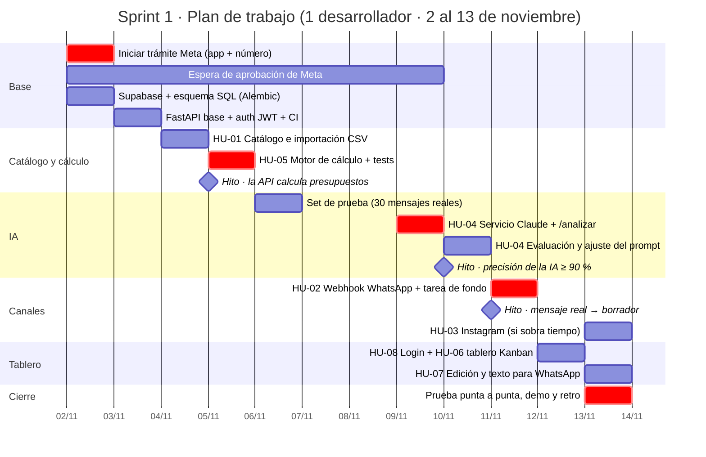
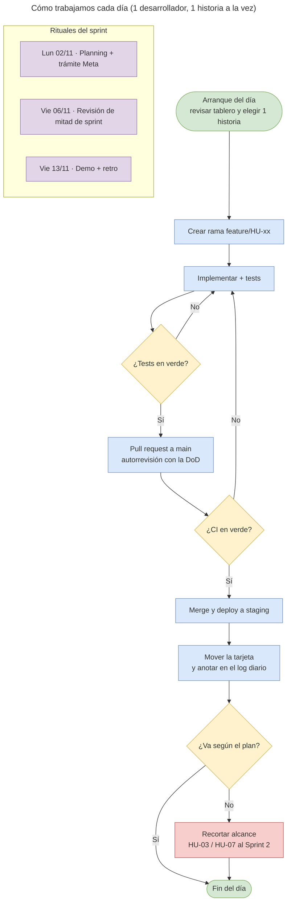

# Sprint 1 — Plan de trabajo

Fecha: 2026-11-01 · Autor: Nicolas Gatti

Sprint de 10 días hábiles, del lunes 2 al viernes 13 de noviembre de 2026, con una sola persona en el equipo. El orden sigue las dependencias: primero la base de datos y el cálculo, después la IA, después los canales y al final el tablero.

## Supuestos

- Una persona a tiempo completo, una historia en curso a la vez.
- 45 puntos en total. Con una sola persona es un sprint ajustado, así que el alcance se divide en dos niveles:

| Prioridad | Historias | Puntos |
| --- | --- | --- |
| Imprescindible | HU-01, HU-02, HU-04, HU-05, HU-06, HU-08 | 37 |
| Si sobra tiempo | HU-07 (edición y texto para WhatsApp), HU-03 (Instagram) | 8 |

## Cronograma día por día

| Día | Fecha | Trabajo | Entregable |
| --- | --- | --- | --- |
| 1 | Lun 02/11 | Iniciar trámite en Meta (app + número de prueba). Crear proyecto Supabase y aplicar el esquema con Alembic. Repo y CI | Base de datos creada |
| 2 | Mar 03/11 | Esqueleto FastAPI: configuración, `/health`, errores, validación de JWT (parte backend de HU-08) | API desplegada en staging |
| 3 | Mié 04/11 | HU-01: endpoints de catálogo, importación CSV y activación de lista | Lista de precios cargada |
| 4 | Jue 05/11 | HU-05: motor de cálculo con escalas y pruebas unitarias | **Hito: la API calcula presupuestos** |
| 5 | Vie 06/11 | Armar el set de prueba: 30 mensajes reales con su presupuesto esperado. Revisión de mitad de sprint | Set de prueba listo |
| 6 | Lun 09/11 | HU-04: servicio `interpretar_mensaje` con Claude y endpoint `/mensajes/analizar` | Primer pedido interpretado |
| 7 | Mar 10/11 | HU-04: script de evaluación y ajuste del prompt | **Hito: precisión ≥ 90 %** |
| 8 | Mié 11/11 | HU-02: webhook de WhatsApp con firma e idempotencia, tarea de fondo que crea el borrador | **Hito: mensaje real → borrador** |
| 9 | Jue 12/11 | HU-08 login y HU-06 tablero Kanban con Realtime e historial | Tablero funcionando |
| 10 | Vie 13/11 | Mañana: HU-07 (o HU-03). Tarde: prueba punta a punta con un teléfono real, demo y retro | **Demo del sprint** |

## Paso a paso por día

Cada día tiene una lista para ir tildando y una condición de "listo" para saber si se puede pasar al día siguiente. Si un día no se cierra, aplicar las [reglas de recorte](#reglas-de-recorte) antes de seguir.

### Rutina de todos los días

**Al arrancar (10 min)**

- [ ] Leer el log del día anterior y la lista de hoy.
- [ ] Mover a "En curso" la historia del día (una sola).
- [ ] Mirar si llegó algo de Meta (mail o panel de desarrolladores).

**Al cerrar (10 min)**

- [ ] Hacer commit y push de todo lo hecho, aunque esté a medias (en la rama).
- [ ] Escribir el log del día en `docs/log-sprint1.md`:

```markdown
## Lun 02/11
- Hice: ...
- Sigue: ...
- Bloqueos: ...
```

### Día 1 · Lun 02/11 · Base del proyecto

**Mañana**

- [ ] Crear la app en Meta for Developers (tipo Business), agregar el producto WhatsApp y obtener el número de prueba. Es lo primero porque la aprobación puede tardar días.
- [ ] Guardar App ID, App Secret, token y Phone Number ID en un gestor de contraseñas, nunca en el repo.
- [ ] Crear el repositorio git con las carpetas `backend/`, `frontend/` y `docs/`, y mover ahí esta documentación.
- [ ] Agregar `.gitignore` y `.env.example` con las variables: `DATABASE_URL`, `SUPABASE_URL`, `SUPABASE_SERVICE_ROLE_KEY`, `SUPABASE_JWT_SECRET`, `ANTHROPIC_API_KEY`, `META_APP_SECRET`, `META_VERIFY_TOKEN`, `WHATSAPP_TOKEN`, `WHATSAPP_PHONE_NUMBER_ID`.

**Tarde**

- [ ] Crear el proyecto en Supabase (región São Paulo, la más cercana).
- [ ] En `backend/`, crear el entorno virtual con Python 3.12 e instalar `fastapi`, `uvicorn`, `sqlalchemy`, `alembic`, `psycopg`, `pydantic-settings`, `anthropic`, `httpx`, `pytest` y `ruff`.
- [ ] Inicializar Alembic y escribir la primera migración con el esquema de la sección 2 de la documentación técnica.
- [ ] Aplicar la migración y verificar en el panel de Supabase que están las 8 tablas.

**Listo cuando:** la migración está aplicada, el repo tiene su primer commit y el trámite de Meta está iniciado.

### Día 2 · Mar 03/11 · API base y despliegue

- [ ] Armar la estructura: `app/main.py`, `app/config.py`, `app/db.py`, `app/routers/`, `app/services/`, `tests/`.
- [ ] Endpoint `/health` que hace un `SELECT 1` contra la base.
- [ ] Formato de error único para toda la API (`{"error": ..., "detalle": ...}`).
- [ ] Dependencia de autenticación que valida el JWT de Supabase; dejar afuera `/health` y `/webhooks/*`.
- [ ] Tests: sin token responde 401; `/health` responde 200.
- [ ] CI con GitHub Actions que corre `pytest` y `ruff` en cada pull request.
- [ ] Desplegar en Railway o Render con las variables de entorno y abrir `/health` y `/docs` en la URL pública.
- [ ] Crear el tablero personal (GitHub Projects o Trello) con las 8 historias.

**Listo cuando:** `/health` responde en la URL pública y la CI está en verde.

### Día 3 · Mié 04/11 · HU-01 Catálogo y lista de precios

- [ ] Modelos SQLAlchemy de `productos`, `listas_precios` y `precios`.
- [ ] Endpoints de productos: crear, listar y editar (talles, colores, alias, activo).
- [ ] Importación CSV: validar todas las filas antes de guardar y hacerlo en una sola transacción; si falla, devolver línea y código.
- [ ] Activar lista: en una transacción, desactivar la anterior y activar la nueva.
- [ ] `GET /listas-precios/activa`.
- [ ] Armar el CSV con el catálogo real de la fábrica: productos, talles, colores y alias que usan los clientes.
- [ ] Tests de los 4 criterios de aceptación de HU-01.

**Listo cuando:** la lista de precios real está cargada y activa en staging.

### Día 4 · Jue 05/11 · HU-05 Motor de cálculo

- [ ] Escribir `calcular_presupuesto(items, lista)` como función pura, sin acceso a la base.
- [ ] Escala por cantidad total del producto; el precio por talle tiene prioridad sobre el general.
- [ ] Los ítems sin producto no suman y marcan el presupuesto para revisión.
- [ ] Tests de borde: 11, 12, 49 y 50 unidades; precio por talle; ítem sin producto; total con descuento.
- [ ] Endpoint `POST /presupuestos/calcular`.
- [ ] Confirmar con la fábrica las preguntas abiertas: escala por producto o por ítem, precios con o sin IVA.
  - Se cargan en el frontend (**Configuración → Reglas comerciales**); el motor las aplica y se genera una ficha (PDF o WhatsApp) para que la fábrica las confirme.

**Listo cuando:** todos los tests del motor pasan. **Hito: la API calcula presupuestos.**

### Día 5 · Vie 06/11 · Set de prueba y revisión de mitad de sprint

**Mañana**

- [ ] Juntar 30 mensajes reales de WhatsApp e Instagram y anonimizar nombres y teléfonos.
- [ ] Mezcla sugerida: 15 pedidos simples, 8 complejos (curvas, varios productos, talles repartidos), 4 con productos fuera de lista y 3 sin pedido.
- [ ] Escribir el resultado esperado de cada uno (ítems y total) en `backend/tests/fixtures/set_prueba.json`.

**Tarde**

- [ ] Empezar HU-04: esquema Pydantic `PedidoExtraido` y el system prompt en `app/ia/prompt.py`.
- [ ] Revisión de mitad de sprint (30 min): ¿están HU-01 y HU-05? ¿respondió Meta? Aplicar las reglas de recorte si hace falta.

**Listo cuando:** el set de 30 casos está escrito con sus resultados esperados.

### Día 6 · Lun 09/11 · HU-04 Servicio de IA

- [ ] Función que arma el bloque `<lista_precios>` a partir de la lista activa.
- [ ] Interfaz `InterpreteIA` con `OllamaInterprete` y `ClaudeInterprete`, elegida por `IA_PROVEEDOR` (sección 4, "Proveedor de IA intercambiable"). Instalar Ollama y bajar un modelo (ej. `qwen2.5:14b`).
- [ ] Servicio `interpretar_mensaje` con `messages.parse` y prompt caching para Claude, y `format` con el JSON Schema para Ollama (sección 4).
- [ ] Manejar `stop_reason == "refusal"` y los errores de la API: la interacción queda con `estado_ia = error`.
- [ ] `POST /mensajes/analizar`: interpreta, calcula y devuelve; solo guarda si `guardar=true`.
- [ ] Guardar `resultado_ia`, modelo y tokens en `interacciones`.
- [ ] Probar a mano con 5 mensajes del set.
- [ ] Mirar el consumo en la consola de Anthropic.

**Listo cuando:** `/mensajes/analizar` devuelve un presupuesto correcto para los 5 mensajes probados.

### Día 7 · Mar 10/11 · HU-04 Evaluación y ajuste

- [ ] Script `scripts/evaluar.py`: corre los 30 casos, compara producto, talle, color y cantidad, y muestra el porcentaje y la lista de fallos.
- [ ] Primera corrida; guardar el resultado como línea de base.
- [ ] Corregir según los fallos (reglas del prompt o alias del catálogo) y volver a correr. Como máximo 3 vueltas.
- [ ] Comparar esfuerzo `low` contra el valor por defecto: precisión, tiempo y costo.
- [ ] Correr la evaluación con Ollama y con Claude (`--proveedor`) y decidir cuál va a producción según precisión, tiempo y costo. Anotar los números en el log.
- [ ] `POST /interacciones/{id}/reprocesar`.

**Listo cuando:** la evaluación da 90 % o más. **Hito: precisión de la IA ≥ 90 %.**

### Día 8 · Mié 11/11 · HU-02 Webhook de WhatsApp

- [ ] `GET /webhooks/whatsapp`: verificación con `META_VERIFY_TOKEN`.
- [ ] `POST /webhooks/whatsapp`: validar `X-Hub-Signature-256` con `META_APP_SECRET` sobre el cuerpo crudo de la petición.
- [ ] Procesar solo mensajes de texto; otros tipos (audio, imagen) quedan como `no_aplica`.
- [ ] Buscar o crear el cliente por teléfono (formato E.164) e insertar la interacción con `id_externo` sin duplicar.
- [ ] Responder 200 enseguida y, en segundo plano, interpretar, calcular y crear el presupuesto en Borrador.
- [ ] Configurar la URL del webhook en Meta (staging) y suscribirse a `messages`.
- [ ] Agregar tu celular como destinatario de prueba y mandar un pedido real.
- [ ] Tests: firma inválida da 401; un mensaje repetido no se duplica.

**Listo cuando:** un pedido mandado desde tu celular crea un presupuesto en Borrador. **Hito: mensaje real → borrador.** Si Meta no aprobó, ver las reglas de recorte.

### Día 9 · Jue 12/11 · HU-08 Login y HU-06 Tablero

- [ ] Crear el frontend con Next.js y TypeScript, e instalar `@supabase/supabase-js`.
- [ ] Pantalla de login con Supabase Auth y crear tu usuario.
- [ ] Cliente HTTP que envía el JWT a la API.
- [ ] Tablero con `GET /tablero`: 6 columnas y tarjetas con cliente, canal, total, resumen y marca de revisión.
- [ ] Arrastrar tarjetas (por ejemplo con dnd-kit) y guardar con `PATCH /presupuestos/{id}/etapa`; pedir el motivo al mover a Perdido.
- [ ] Suscripción Realtime a `presupuestos` para que las tarjetas nuevas aparezcan solas.
- [ ] Desplegar en Vercel con las variables de entorno.

**Listo cuando:** entrás con tu usuario, ves el tablero y movés una tarjeta en la URL de Vercel.

### Día 10 · Vie 13/11 · Cierre del sprint

**Mañana**

- [ ] HU-07: detalle del presupuesto, edición de ítems y botón "Copiar texto para WhatsApp". Si ya está, HU-03 (Instagram).

**Tarde**

- [ ] Prueba punta a punta: pedido real por WhatsApp → tarjeta en el tablero → mover a Enviado.
- [ ] Revisar la definición de terminado de cada historia.
- [ ] Demo: grabar un video corto (3 minutos) del flujo completo.
- [ ] Retro con el log del sprint: qué salió bien, qué no, qué cambio para el Sprint 2.
- [ ] Pasar lo que no se terminó al backlog del Sprint 2 con una nota del estado.

**Listo cuando:** la demo está grabada y la retro escrita.

## Diagrama de Gantt



Las tareas en rojo (`crit`) forman el camino crítico: si se atrasan, se atrasa la demo.

## Flujo de trabajo diario



## Tablero personal

| Por hacer | En curso (máx. 1) | En revisión | Hecho |
| --- | --- | --- | --- |
| Historias del sprint, ordenadas por el cronograma | La historia del día | PR abierto esperando CI | Mergeado y desplegado en staging |

- **Una sola tarjeta en curso.** Si una historia se bloquea (por ejemplo, Meta no aprobó), se pasa a la siguiente del cronograma y la bloqueada vuelve a "Por hacer" con una nota.
- **Log diario:** tres líneas al cerrar el día (qué hice, qué sigue, qué me bloquea). Sirve para la retro.

## Reglas de recorte

| Situación | Decisión |
| --- | --- |
| El viernes 06/11 el motor de cálculo (HU-05) no está terminado | HU-07 pasa al Sprint 2 |
| El martes 10/11 la precisión de la IA está por debajo del 90 % | Se sigue con HU-02 igual; los casos que fallan quedan marcados para revisión humana y el ajuste del prompt sigue en el Sprint 2 |
| El miércoles 11/11 Meta todavía no aprobó el número | La demo se hace con `/mensajes/analizar`; HU-02 queda lista para activar cuando llegue la aprobación |
| El jueves 12/11 el tablero no está terminado | HU-03 y HU-07 pasan al Sprint 2; el viernes se dedica a terminar HU-06 |

## Cómo abrir los diagramas en draw.io

Los dos diagramas están en formato Mermaid. GitHub y VS Code los muestran directamente. Para editarlos en draw.io: menú **Insertar (+) → Avanzado → Mermaid**, y pegar el bloque de código.
